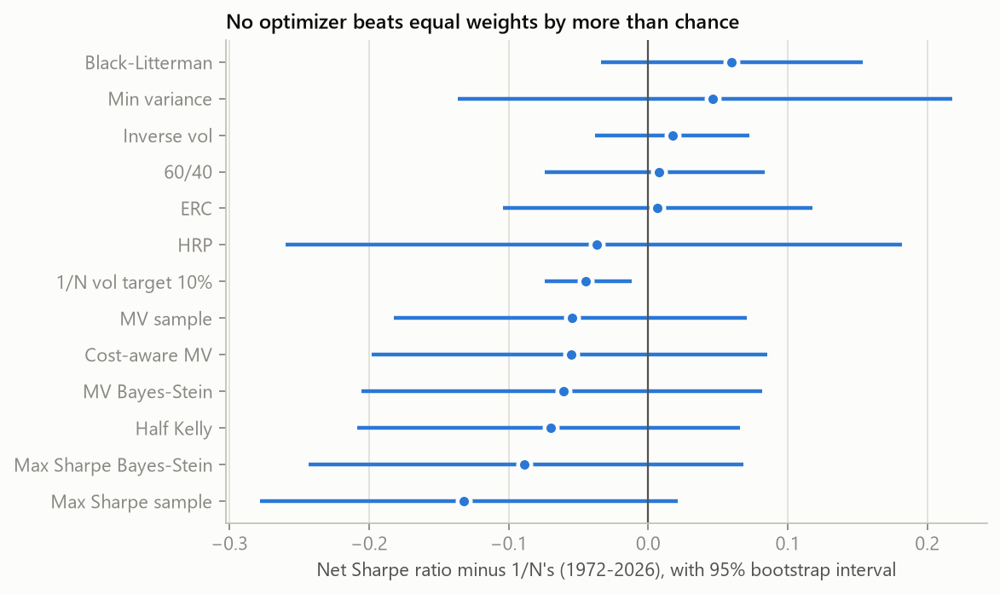
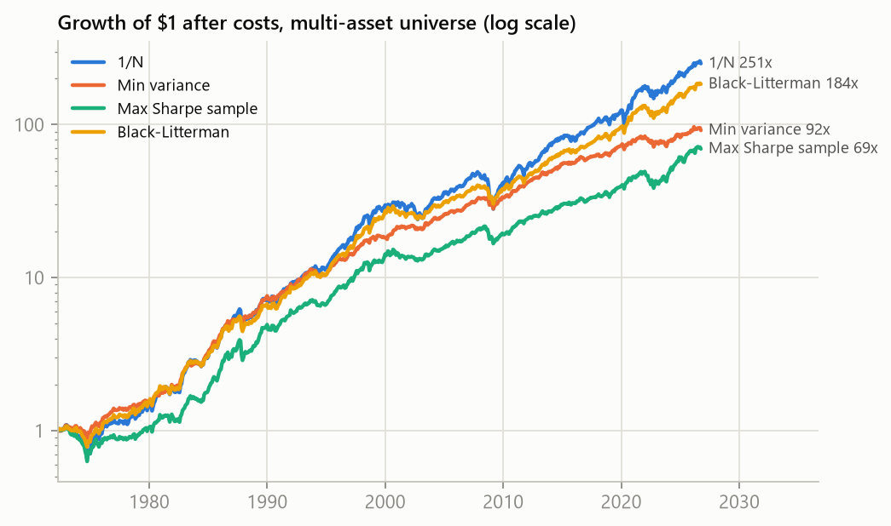
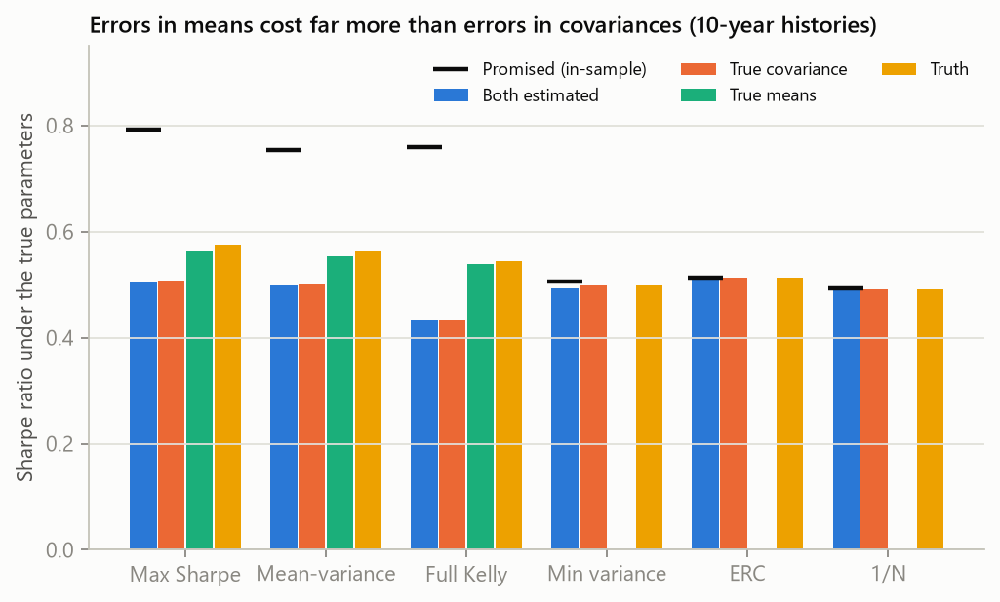
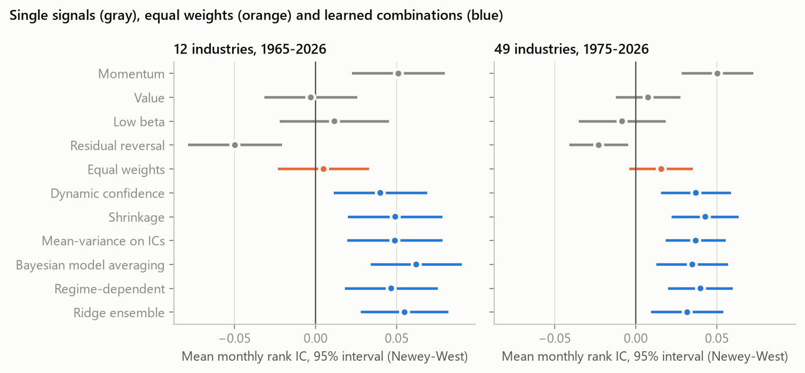

# Optimizers, estimation error and signal combination: a pre-registered study on public data

*Research report for the `quant-portfolio-manager` engine. Design fixed in [PREREGISTRATION.md](PREREGISTRATION.md)
before the runs; deviations are listed at the end. Every number here is produced by `scripts/run_experiments.py`
and `scripts/make_report.py` from public data, and the tables in [tables/](tables/) are the generated versions.*

## Summary

- **No optimizer beat equal weights by more than chance.** Over 1972-2026, after costs, on 12 US industries plus
  10- and 5-year Treasuries, 13 methods were tested against 1/N. The best, Black-Litterman with momentum views,
  led by 0.06 Sharpe (95% interval −0.03 to +0.15). Maximum Sharpe on sample means trailed by 0.13 (−0.28 to
  +0.02). After Holm correction nothing is significant in either direction.
- **Risk-based methods bought the same Sharpe ratio with much less risk.** Minimum variance ran at 7.7%
  volatility with an 18% worst drawdown, against 13.1% and 43% for 1/N, at a Sharpe ratio of 0.56 vs 0.51.
- **Errors in expected returns cost about six times more than errors in the covariance.** With known parameters
  and 10-year histories, maximum Sharpe promised a Sharpe ratio of 0.79 and delivered 0.51. Knowing the true
  means recovered 0.56 of the attainable 0.57; knowing the true covariance recovered nothing (0.51).
- **Learned signal combinations beat equal weights, against the pre-registered expectation, and the reason is
  one wrong-signed signal.** Industry residual reversal has a reliably negative IC (industries trend at one
  month). Learned methods dropped or flipped it. Equal weights with that sign fixed by hand did as well as
  learning (exploratory).
- **Shrinkage and factor covariance estimators barely mattered once positions were capped**, and longer
  estimation windows helped every method that uses expected returns.
- **Kelly sizing on sample means produced the highest growth and catastrophic drawdowns**: full Kelly fell 86%
  from peak, half Kelly 78%.
- **Risk models.** Unconditional 99% VaR on daily data breached too often or in clusters; filtered historical
  simulation got the breach count right (169 vs 156 expected) but breaches still cluster.

Optimization did not create alpha here. Where a method did better, it came from better inputs (Black-Litterman's
anchoring to market weights, a correctly signed signal) or from taking less risk.

## Data and setup

Public data only. Ken French's value-weighted industry portfolios (12 and 49 industries, total returns, built
from CRSP so they include delisted stocks), French factor returns and the one-month T-bill, and Federal Reserve
H.15 constant-maturity Treasury yields rebuilt into total returns the standard way (buy a par bond at each month
end, reprice it a month later at the new yield; the rebuilt 10-year note returns +20.4% in 2008 and −16.4% in 2022).

| Universe | Assets | Monthly returns | Out-of-sample |
|---|---|---|---|
| multi_asset | 12 industries, 10y and 5y Treasuries | 1962-02 to 2026-09 | 1972-03 to 2026-09 (655 months) |
| industries49 | 49 industries | 1969-07 to 2026-09 | from 1979 |
| sleeves | Mkt-RF, SMB, HML, RMW, CMA, Mom, ST_Rev, LT_Rev, Term, each collateralised in T-bills | 1963-07 to 2026-09 | from 1973 |

Walk-forward: at each month end a method sees only the trailing 120 months, trades at the close, and earns the
next month's returns. Costs are charged on every unit of weight traded: 10 bp for industries and sleeves and 2 bp
for Treasuries in the base case, 30 and 5 bp in the high-cost case, plus 30 bp a year to borrow for shorts. The
default covariance is Ledoit-Wolf constant-correlation shrinkage, positions are long-only and capped at 25%, and
mean-variance risk aversion is 4. Sharpe differences are tested with the Jobson-Korkie-Memmel test and a paired
stationary bootstrap (mean block 6 months, 5,000 draws), Holm-corrected within each family of comparisons.

## E1. The horse race



| Method | Return | Volatility | Sharpe | Sharpe, high costs | Max drawdown | Turnover/yr | vs 1/N | 95% CI | p (Holm) |
|---|---|---|---|---|---|---|---|---|---|
| 1/N | 10.7% | 13.1% | 0.51 | 0.51 | 43% | 0.31 |  |  |  |
| 60/40 | 9.4% | 10.0% | 0.52 | 0.51 | 29% | 0.38 | +0.01 | [-0.07, +0.08] | 1.00 |
| Inverse vol | 9.7% | 10.3% | 0.53 | 0.53 | 32% | 0.31 | +0.02 | [-0.04, +0.07] | 1.00 |
| Min variance | 8.6% | 7.7% | 0.56 | 0.55 | 18% | 0.49 | +0.05 | [-0.14, +0.22] | 1.00 |
| ERC | 8.8% | 8.8% | 0.52 | 0.51 | 28% | 0.30 | +0.01 | [-0.10, +0.12] | 1.00 |
| HRP | 7.5% | 6.7% | 0.48 | 0.47 | 14% | 0.41 | -0.04 | [-0.26, +0.18] | 1.00 |
| MV sample | 9.9% | 13.1% | 0.46 | 0.44 | 39% | 1.60 | -0.05 | [-0.18, +0.07] | 1.00 |
| MV Bayes-Stein | 9.0% | 11.0% | 0.45 | 0.43 | 31% | 1.39 | -0.06 | [-0.21, +0.08] | 1.00 |
| Max Sharpe sample | 8.1% | 10.7% | 0.38 | 0.36 | 41% | 1.56 | -0.13 | [-0.28, +0.02] | 0.99 |
| Max Sharpe Bayes-Stein | 8.2% | 9.7% | 0.42 | 0.40 | 34% | 1.38 | -0.09 | [-0.24, +0.07] | 1.00 |
| Black-Litterman | 10.0% | 10.1% | 0.57 | 0.54 | 27% | 1.73 | +0.06 | [-0.03, +0.15] | 1.00 |
| Half Kelly | 11.4% | 18.9% | 0.44 | 0.42 | 56% | 2.43 | -0.07 | [-0.21, +0.07] | 1.00 |
| Cost-aware MV | 9.1% | 11.1% | 0.46 | 0.44 | 31% | 0.91 | -0.06 | [-0.20, +0.09] | 1.00 |
| 1/N vol target 10% | 9.0% | 10.4% | 0.47 | 0.46 | 39% | 0.27 | -0.04 | [-0.07, -0.01] | 0.07 |



Every interval but one straddles zero. The exception is the volatility target on 1/N, which LOST 0.04 Sharpe with
a tight interval (−0.07 to −0.01, Holm p 0.07 by bootstrap, 0.03 by Jobson-Korkie); the two books are highly
correlated, so even a small difference is measured precisely. Cederburg, O'Doherty, Wang and Yan (2020) likewise
find that most volatility-managed portfolios fail to beat their unmanaged versions in real time. Costs barely matter at these turnovers: the high-cost case moves no Sharpe ratio
by more than 0.03. Sharpe ratios by decade swing far more between decades than between methods (all methods were
negative in the 1970s, near 1 or above in the 2010s), which is why a 55-year sample still cannot separate methods
whose true difference is a few hundredths.

The smoke test before the pre-registration (40% caps) put sample-mean maximum Sharpe at 0.26, significantly below
1/N; with 25% caps it reached 0.38. Tighter constraints act like shrinkage of the inputs (Jagannathan and Ma 2003).

## E2. What estimation error costs



The full-sample mean and covariance of multi_asset excess returns serve as the truth; 300 normal histories of each
length are simulated, re-estimated (sample means, Ledoit-Wolf covariance) and re-optimized, and each portfolio is
scored by its TRUE Sharpe ratio.

| T (months) | Method | Promised | Delivered | With true means | With true covariance | Truth |
|---|---|---|---|---|---|---|
| 60 | Max Sharpe | 0.90 | 0.49 | 0.55 | 0.50 | 0.57 |
| 120 | Max Sharpe | 0.79 | 0.51 | 0.56 | 0.51 | 0.57 |
| 240 | Max Sharpe | 0.72 | 0.52 | 0.57 | 0.52 | 0.57 |
| 120 | Mean-variance | 0.75 | 0.50 | 0.55 | 0.50 | 0.56 |
| 120 | Full Kelly | 0.76 | 0.43 | 0.54 | 0.43 | 0.54 |
| 120 | Min variance | 0.51 | 0.49 |  | 0.50 | 0.50 |
| 120 | ERC | 0.51 | 0.51 |  | 0.51 | 0.51 |
| 120 | 1/N | 0.49 | 0.49 |  | 0.49 | 0.49 |

Two lessons. First, almost the whole loss comes from the means. For maximum Sharpe with 10-year histories, errors
in the means alone cost 0.066 of Sharpe (truth 0.574, true covariance with estimated means 0.508) and errors in the
covariance alone 0.011 (true means with estimated covariance 0.563); Chopra and Ziemba (1993) found errors in
means roughly ten times as costly as errors in variances. Second, return-based optimizers promise far more than they deliver
(0.79 promised vs 0.51 delivered), while risk-based ones promise about what they deliver. Even with perfect
knowledge the best constrained portfolio beats 1/N by only 0.08 Sharpe in this universe (0.57 vs 0.49), so there
is little to win and a lot to lose. Full Kelly with estimated means delivers an expected log growth of 12.9% a year
against 16.2% for Kelly on the truth (10-year histories).

## E3. Sensitivity to inputs

**Covariance estimators** hardly matter for capped minimum-variance portfolios. On multi_asset every estimator gave
7.7-7.8% realised volatility; on 49 industries (10% caps) 12.8-13.1%. H6 (shrinkage or factor models beat the
sample covariance on 49 industries) is rejected: the only significant improvement is EWMA with a 120-month window
(t = −2.27 on the variance difference); Ledoit-Wolf identity and the six-factor model were slightly worse. Turnover
differs more than risk: the factor model trades least (0.80 a year vs 0.90 for the sample). With position caps,
the constraints rather than the estimator decide most of the portfolio.

**Expected-return inputs** for mean-variance (same constraints): sample means Sharpe 0.46, Bayes-Stein 0.45,
James-Stein toward the grand mean 0.48, equilibrium 0.55, none (minimum variance) 0.56, and a momentum-signal
input 0.65 at 2.4 turnover. The less a mean estimate relies on each asset's own history, the better it did; the
momentum input is the only one that added information (descriptive, not tested).

**Window length** (common sample from 1982): longer windows helped every return-based method (maximum Sharpe with
Bayes-Stein means 0.58 / 0.65 / 0.70 for 5 / 10 / 20 years) and cut turnover, while minimum variance was flat
(0.74-0.76) and beat 1/N's 0.66 over this shorter period.

## E4. Combining signals

Four reference signals computed point in time on industry portfolios (momentum 12-1, book-to-market, low beta,
residual reversal) were combined walk-forward by seven methods; at each month the learned methods see only ICs and
returns realised by then.



| Universe | Method | IC gain vs equal | t | p (Holm) |
|---|---|---|---|---|
| industries12 | Dynamic confidence | +0.035 | 2.56 | 0.028 |
| industries12 | Shrinkage | +0.044 | 2.83 | 0.028 |
| industries12 | Mean-variance on ICs | +0.044 | 2.81 | 0.028 |
| industries12 | Bayesian model averaging | +0.057 | 2.68 | 0.028 |
| industries12 | Regime-dependent | +0.042 | 2.74 | 0.028 |
| industries12 | Ridge ensemble | +0.050 | 2.55 | 0.028 |
| industries49 | Dynamic confidence | +0.021 | 2.26 | 0.071 |
| industries49 | Shrinkage | +0.027 | 2.94 | 0.019 |
| industries49 | Mean-variance on ICs | +0.021 | 2.60 | 0.038 |
| industries49 | Bayesian model averaging | +0.019 | 1.49 | 0.271 |
| industries49 | Regime-dependent | +0.024 | 2.95 | 0.019 |
| industries49 | Ridge ensemble | +0.016 | 1.22 | 0.271 |

**H4 is rejected.** Learned weights beat equal weights on 12 industries for all six methods and on 49 industries
for three. The single signals explain why: momentum has an IC of +0.050 (t 3.5 and 4.5), value and low beta are
indistinguishable from zero, and residual reversal is reliably NEGATIVE (−0.050, t −3.4 on 12 industries; −0.023,
t −2.5 on 49). At the industry level last month's winners keep winning (Moskowitz and Grinblatt 1999); the
stock-level reversal effect does not carry over. Equal weights keeps the wrong-signed signal at full weight; the
learned methods floor it at zero (and Bayesian model averaging, which allows negative coefficients, flips it: its
posterior inclusion probability for reversal averaged 0.56 on 12 industries).

**Exploratory follow-up (X1, not pre-registered).** With the reversal sign fixed by hand, equal weights reached an
IC of 0.059 on 12 industries and 0.035 on 49, level with the learned shrinkage method (differences −0.010, t −0.6,
and +0.008, t 0.7). Dropping the signal instead gave 0.033 and 0.028. So learning won by catching one sign error,
not by finer weighting. That is a real benefit, since sign errors happen, but a careful analyst gets it for free.

As portfolios (dollar-neutral, proportional to the combined score, 10 bp costs), equal weights lost money (net
Sharpe −0.22 and −0.08) and the learned methods earned 0.11-0.34 at turnover of 4.7-11 times a year.

## E5. When does learning help? (synthetic signals with known ICs)

Share of the oracle's IC captured (49 assets, 480 months, 4 seeds per case):

| Case | Equal | Dynamic confidence | Shrinkage | MV on ICs | BMA | Regime | Ridge |
|---|---|---|---|---|---|---|---|
| strong, stable | 82% | 93% | 91% | 98% | 94% | 93% | 98% |
| weak, stable | 91% | 93% | 94% | 95% | 81% | 95% | 90% |
| time-varying | 37% | 50% | 46% | 49% | 43% | 48% | 46% |
| regime flips | 47% | 60% | 55% | 62% | 62% | 74% | 54% |
| many junk signals | 66% | 84% | 78% | 90% | 99% | 83% | 86% |

Learning pays when signals differ in strength or some are junk (Bayesian model averaging captures 99% of the
oracle with five junk signals, equal weights 66%). With uniformly weak signals equal weights is as good as anything
and BMA's strict evidence threshold drops real signals (81%). Regime-dependent weights help only when signals
truly flip with an observable regime. Nothing works well when ICs drift (37-50%).

## E6. Allocating across strategy sleeves

Nine factor sleeves, each standing in for one research system's return stream (collateralised, so sleeve returns
are T-bill plus factor return). Correlations are low (−0.36 to +0.68), so every method earns a Sharpe ratio near 1.

| Strategy | Return | Volatility | Sharpe | Max drawdown | Turnover/yr |
|---|---|---|---|---|---|
| 1/N | 8.4% | 3.9% | 1.04 | 11% | 0.27 |
| ERC | 7.8% | 3.3% | 1.04 | 9% | 0.29 |
| Inverse vol | 7.8% | 3.6% | 0.96 | 8% | 0.26 |
| Min variance | 7.4% | 3.3% | 0.95 | 6% | 0.38 |
| HRP | 7.5% | 3.5% | 0.91 | 8% | 0.88 |
| MV Bayes-Stein | 10.3% | 6.3% | 0.93 | 11% | 1.18 |
| Max Sharpe Bayes-Stein | 8.4% | 3.6% | 1.14 | 7% | 0.54 |

H7 (ERC beats 1/N) is rejected: −0.01 (−0.14 to +0.13). The best, maximum Sharpe with shrunk means, led by 0.09
(−0.15 to +0.34), not significant.

## E7. Risk overlays

| Strategy | Return | Volatility | Sharpe | Max drawdown | Turnover/yr |
|---|---|---|---|---|---|
| 1/N | 10.7% | 13.1% | 0.51 | 43% | 0.31 |
| 1/N + vol target 10% | 9.0% | 10.4% | 0.47 | 39% | 0.27 |
| 1/N + drawdown governor | 8.7% | 9.7% | 0.46 | 22% | 0.90 |
| ERC | 8.8% | 8.8% | 0.52 | 28% | 0.30 |
| ERC + vol target 10% | 8.6% | 8.4% | 0.52 | 28% | 0.30 |
| ERC + drawdown governor | 8.1% | 7.5% | 0.50 | 15% | 0.71 |

A drawdown governor (exposure falls linearly as the drawdown approaches 20%, floor 25%) halved the worst drawdown
of both portfolios for about 0.02-0.05 of Sharpe and two to three times the turnover. The volatility target cost
Sharpe on 1/N and did nothing for ERC. On the sleeves (volatility 3-4%) a 10% target never binds without leverage.

## E8. Kelly sizing

| Strategy | Return | Volatility | Sharpe | Max drawdown | Turnover/yr | Log growth |
|---|---|---|---|---|---|---|
| 1/N | 10.7% | 13.1% | 0.51 | 43% | 0.31 | 10.1% |
| Full Kelly | 12.8% | 37.1% | 0.40 | 86% | 4.47 | 12.0% |
| Half Kelly | 14.4% | 31.5% | 0.45 | 78% | 3.98 | 13.4% |
| Quarter Kelly | 11.6% | 21.5% | 0.42 | 57% | 3.56 | 11.0% |

With sample means and up to 2x leverage, Kelly-type sizing grew wealth faster than 1/N over 55 years, and half
Kelly faster than full Kelly (as theory predicts when the inputs are noisy), but at drawdowns no allocator could
survive. E2 shows why: estimated means make full Kelly bet as if its Sharpe ratio were 0.76 when it is 0.43.

## E9. Capacity and execution

With square-root impact (η = 0.5, ADV = 0.4% of industry market value a day, $50bn for Treasuries), costs stay
small for 1/N and ERC even at $10bn (0.16% and 0.08% a year) but reach 0.57% a year for cost-aware mean-variance,
whose Sharpe ratio falls from 0.45 at $0.1bn to 0.41. The same 1/N book executed through the router adapter's
stand-in router (command-line transport) cost 0.052% a year against 0.049% with the built-in model, confirming
the integration path end to end.

**Exploratory (X3): the real smart order router.** The separate `multi-venue-smart-router` repository was called
through the adapter's Python transport. On its standard parent order (24 simulated episodes) the naive NBBO sweep
cost 3.67 bp, the synchronised sweep 3.27 bp and the full smart router −0.05 bp. Most of the smart router's edge
is resting orders instead of crossing the spread, which its own report calls an upper bound; pure routing
(synchronisation) was worth 0.39 bp. At these portfolios' turnover that is 0.01-0.09% a year: routing matters for
high-turnover books, not for monthly allocation. All router reports passed the execution contract.

## E10. Risk model checks

Rolling 99% one-day VaR on daily multi-asset 1/N returns, 500-day windows, 1964-2026:

| Model | Exceptions | Expected | Kupiec p | Clustering p |
|---|---|---|---|---|
| Historical | 242 | 156 | 0.000 | 0.000 |
| Normal | 351 | 156 | 0.000 | 0.000 |
| Cornish-Fisher | 149 | 156 | 0.555 | 0.000 |
| EWMA normal (exploratory) | 314 | 156 | 0.000 | 0.000 |
| Filtered historical simulation (exploratory) | 169 | 156 | 0.313 | 0.001 |

Unconditional models fail: two years of history cannot see a regime change coming, so breaches arrive in clusters.
A conditional normal model reacts but has tails that are too thin. Filtered historical simulation, which scales
the empirical distribution of standardised returns by today's EWMA volatility, gets the count right; its breaches
still cluster, less so. One caution from the current risk report: on the last two years of daily data the
Cornish-Fisher expansion put 1/N's one-day VaR at 4.6% against 1.7% historical, because the expansion misbehaves at
high kurtosis.

**Correlation breakdown.** In months whose trailing 12-month market volatility is in the top fifth, the average
correlation among the 12 industries rises from 0.60 to 0.69, and the stock-bond correlation falls from +0.18 to
−0.02. By decade the stock-bond correlation was +0.18 to +0.34 from the 1960s to the 1990s, −0.25 and −0.49 in the
2000s and 2010s, and +0.28 in the 2020s, which is the regime that makes 2022-style losses on both legs possible.

**Stress tests** of the current portfolios (weights as of 2026-09): the 2008 replay costs 1/N 34%, ERC 18%, minimum
variance 11% and sample maximum Sharpe 37%; the hypothetical AI-capex reversal costs them 13%, 7%, 4% and 20%.

## Hypotheses scorecard

| | Hypothesis | Result |
|---|---|---|
| H1 | No estimated-mean method beats 1/N | Supported: none significant after Holm (best +0.06, Black-Litterman) |
| H2 | Risk-based methods: lower volatility and drawdown, same Sharpe | Supported for minimum variance, ERC and HRP |
| H3 | Bayes-Stein means beat sample means | Rejected: −0.006 (p 0.86) for mean-variance, +0.043 (p 0.066) for maximum Sharpe |
| H4 | No learned combination beats equal weights | Rejected (all six on 12 industries, three of six on 49), because of one wrong-signed signal |
| H5 | Mean errors cost more than covariance errors | Supported: 0.066 vs 0.011 of Sharpe (maximum Sharpe, 10-year histories) |
| H6 | Shrinkage or factor covariance beats the sample on 49 industries | Rejected: only EWMA at 120 months (t −2.27) |
| H7 | ERC beats 1/N on the sleeves | Rejected: −0.01 |

## Deviations from the pre-registration

1. The first decision dates are one month later than written (1972-02 rather than 1972-01, and likewise for the
   other universes): the 120-month window includes the decision month.
2. Black-Litterman used risk aversion 2.5, the value its equilibrium prior is computed with; the pre-registered 4
   applies to plain mean-variance.
3. Which p-values go into the Holm correction was not specified; tables show the bootstrap version, and the
   Jobson-Korkie version leads to the same conclusions everywhere.
4. The volatility targets scale down only (no leverage); the pre-registration did not specify leverage.
5. The correlation breakdown (descriptive, E10) first picked stress months by their own market return, which biases
   correlations down (Forbes and Rigobon 2002) and showed stress correlations BELOW normal ones. It was replaced by
   the volatility-regime definition reported above.
6. X1 (sign-aware equal weights), X2 (conditional VaR models) and X3 (the real router) were added after seeing
   results and are labelled exploratory.

## Limitations

- Industry portfolios are not instruments; sector funds and futures exist only for the later decades, so the cost
  assumptions (10 and 30 bp) are assumptions.
- One 14-asset universe carries the main result; with hundreds of assets or genuinely informative signals the
  balance between estimation error and opportunity changes.
- Treasury returns are rebuilt from yields, an approximation that matches published calendar-year returns closely
  but not exactly.
- The reference signals are deliberately simple and public. The engine's adapters accept the author's own
  research systems' signals, but those use licensed or private data and are not part of this public study.
- Sharpe differences of a few hundredths are not detectable in 55 years of monthly data; several "not significant"
  results are absences of evidence, not evidence of equality.
- The router's costs come from its simulated market and are not calibrated to these portfolios.

## Reproduce

```
python scripts/fetch_data.py french && python scripts/fetch_data.py fred
python scripts/build_data.py
python scripts/run_experiments.py           # about 35 minutes; X3 needs the router repository
python scripts/make_report.py               # figures/ and tables/
```
